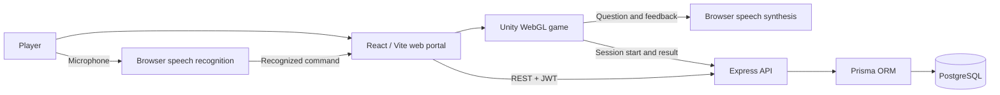
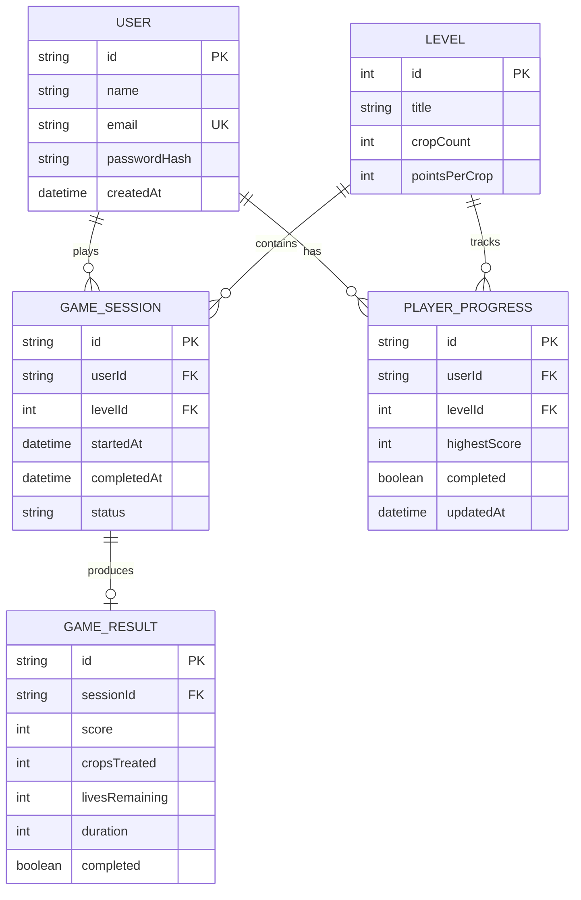

<div align="center">

# 🌱 CropGuard
### A voice-assisted crop health learning game

**Explore the farm · Identify crop problems · Treat plants · Learn by playing**

[Play the game](https://cropguard-rescue-741.craftycord.chatgpt.site/) · [Leaderboard](https://cropguard-rescue-741.craftycord.chatgpt.site/leaderboard) · [API health](https://cropguard-api-hyqt.onrender.com/api/health)

Unity 2D / WebGL • React • Node.js & Express • Prisma • PostgreSQL

</div>

---

## 1. Project overview

CropGuard is an educational farming game that turns crop-health questions into an interactive activity. A player explores a farm, inspects crops, chooses an answer and treats a plant. Three levels, scores and voice commands make the learning experience interactive; an optional account saves completed and failed game sessions to a database.

The project combines a **Unity game**, a **web application and REST API**, and a **relational database**. Visitors can play without an account; signed-in players can review their progress and appear on the leaderboard.

> **Scope:** CropGuard is a learning prototype. Its questions are not a field diagnosis. It does not currently accept crop photographs, connect farmers to experts, or use an AI model to diagnose disease.

## 2. Problem and approach

Recognizing crop-health problems and understanding the next step can be difficult for a learner when information is presented only as text. CropGuard presents short, randomized scenarios in a farm setting and gives immediate feedback. Optional speech recognition and spoken prompts support a hands-free way to interact with the game.

| Need | CropGuard approach |
| --- | --- |
| Practice crop-health concepts | Multiple-choice questions about crop disease and prevention |
| Make learning interactive | Explore a Unity farm, inspect crops and treat them |
| Support hands-free interaction | Browser voice commands and spoken game prompts |
| Track a player's work | Saved sessions, score, history and level progress |
| Allow quick access | Public browser play with an optional account |

## 3. Features

- **Three farming levels:** a daytime farm, a timed moonlight farm and a simple farm built with Unity shapes.
- **Question bank:** randomized scenarios and shuffled answer options; the bank is reused after its questions are exhausted.
- **Voice interaction:** start the microphone once, then say a command; the game can announce a nearby plant, read a question and options, and give answer feedback.
- **Keyboard and on-screen controls:** play without speech recognition.
- **Accounts:** register and sign in with an email and password; passwords are stored as bcrypt hashes.
- **Player dashboard:** game count, best score, crops treated, completed levels and recent history.
- **Leaderboard:** public paginated ranking based on stored results.
- **Guest mode:** play without an account; results from guest sessions are not saved to an account.

## 4. How to play

1. Open the [live game](https://cropguard-rescue-741.craftycord.chatgpt.site/). Choose **Get started** to create an account, **Log in**, or play as a guest.
2. Select **Play game**, then **Play** in the Unity menu.
3. Move toward a crop, inspect it and choose an answer. An incorrect answer costs one life; each level starts with three lives.
4. After a correct answer, apply the solution to save the crop and earn points.
5. Save every crop to complete the level. The next level becomes available after the previous level is completed.

### Keyboard controls

| Action | Key |
| --- | --- |
| Move | `A` / `D` or left / right arrows |
| Jump | `Space` |
| Inspect a nearby crop | `E` |
| Apply the solution after a correct answer | `F` |

### Voice controls

Click **Start voice control** on the game page and allow microphone access. The browser listens for commands while voice control is on. Click **Stop voice control** to turn it off. Speak clearly and use the on-screen buttons or keyboard if recognition is unavailable.

| Say | Action |
| --- | --- |
| `play` / `start` | Start the game from its menu |
| `left` / `right` | Move in that direction briefly |
| `stop` | Stop voice-directed movement |
| `inspect` | Inspect a nearby crop |
| `option one`, `option two`, `option three` | Select and submit that answer |
| `spray`, `treat` or `apply` | Treat the crop after a correct answer |

When voice control is active, the game announces a nearby crop, reads the question and options, and gives correct/incorrect feedback. Voice recognition depends on browser support, microphone permissions and the browser's speech service; in some browsers it needs an internet connection. Listening is paused while a spoken prompt plays to reduce self-recognition. Use headphones in noisy environments.

### Levels and scoring

| Level | Environment | Crops | Points per crop | Special rule |
| --- | --- | ---: | ---: | --- |
| 1 | Farm Rescue | 5 | 100 | Learn the basic inspect-and-treat loop |
| 2 | Moonlight Rescue | 6 | 150 | Finish before the **60-second storm** |
| 3 | Village Farm | 7 | 200 | A simple farm assembled from Unity shapes |

## 5. System architecture



**Game flow:** the browser hosts the Unity WebGL canvas and passes voice commands to Unity. Unity sends spoken-message events back to the browser. For signed-in players, the Unity online bridge opens a level session and submits its result to the API. The API validates the request and stores the session, result and progress in PostgreSQL.

## 6. Database design

The Prisma schema lives in [`backend/prisma/schema.prisma`](backend/prisma/schema.prisma); SQL migrations live in [`backend/prisma/migrations`](backend/prisma/migrations).



Each session belongs to one user and one level and has at most one result. Progress is unique per user and level. The API checks ownership, duplicate submissions, level unlocks, score arithmetic, crop counts and duration. These checks cannot prove a browser client played honestly; rankings are not cheat-proof.

## 7. Technology stack

| Layer | Technology | Responsibility |
| --- | --- | --- |
| Game | Unity 6.5, C#, Unity WebGL | Levels, gameplay, questions and voice bridge |
| Web | React, Vite, CSS | Public site, account pages, dashboard and game host |
| Voice | Browser speech recognition and speech synthesis | Recognize commands and read prompts |
| API | Node.js, Express, Zod, JWT, bcrypt | Authentication, validation and game endpoints |
| Database | PostgreSQL, Prisma ORM | Accounts, sessions, results and progress |
| Hosting | Sites and Render | Web frontend, API and managed database |

## 8. Repository layout

```text
CropGuard/
├── Assets/                  Unity scenes, scripts, resources and WebGL plugin
│   ├── Editor/              WebGL build helper
│   ├── Plugins/WebGL/       Browser event bridge
│   ├── Scenes/              Main menu and three levels
│   └── Scripts/             Gameplay, question bank and online bridge
├── Packages/                Unity package configuration
├── ProjectSettings/         Unity project settings
├── frontend/
│   ├── public/game/Build/   Browser-ready Unity WebGL files
│   └── src/                 React portal and voice controls
├── backend/
│   ├── prisma/              Schema, migrations and level seed
│   ├── src/                 Express application and server
│   └── test/                API integration test
├── render.yaml              Example Render deployment blueprint
└── README.md
```

## 9. Run locally

### Prerequisites

- Node.js 20 or later and npm.
- PostgreSQL and an empty database for this project.
- Unity **6000.5.10f1** with the WebGL build module, if rebuilding the game.
- A modern browser; voice recognition availability varies by browser.

### Backend and database

```bash
cd backend
cp .env.example .env
npm ci
```

Set `DATABASE_URL` to your PostgreSQL database, `JWT_SECRET` to a unique secret of at least 32 characters, `PORT` to `5000`, and `FRONTEND_URL` to the exact frontend origin, for example `http://localhost:5173`. Keep `.env` private.

```bash
npx prisma generate
npx prisma migrate deploy
node prisma/seed.js
npm run dev
```

The API health endpoint is `http://localhost:5000/api/health`.

### Frontend

In another terminal:

```bash
cd frontend
cp .env.example .env
npm ci
npm run dev
```

Set `VITE_API_URL=http://localhost:5000` in `frontend/.env`. Open the address Vite prints. The committed WebGL files allow the portal to run without building Unity first. If using a different Vite port, update the backend `FRONTEND_URL` to match exactly.

### Rebuild the Unity WebGL game

1. Open the repository root as a project in Unity Hub and install the matching WebGL module.
2. In Unity, choose **CropGuard → Build WebGL**, or invoke `WebGLBuild.Build` with the Unity editor in batch mode.
3. The helper writes an uncompressed build to `frontend/public/game/Build/`. The portal expects `game.loader.js`, `game.framework.js`, `game.data`, and a gzip-compressed `game-wasm.bin`:

```bash
# From the repository root, after a successful Unity build:
gzip -9 -c frontend/public/game/Build/game.wasm > frontend/public/game/Build/game-wasm.bin
```

The frontend decompresses `game-wasm.bin` in the browser. Preserve the other generated files and build the frontend with `npm run build` in `frontend/`. Host the resulting site over HTTPS, with an SPA fallback to `index.html`.

## 10. API reference

All responses are JSON. Protected routes use `Authorization: Bearer <token>`.

| Method | Endpoint | Auth | Purpose |
| --- | --- | --- | --- |
| GET | `/api/health` | No | API availability |
| POST | `/api/auth/register` | No | Create an account with name, email and password |
| POST | `/api/auth/login` | No | Sign in and receive a token |
| GET | `/api/auth/me` | Yes | Current account |
| GET | `/api/game/levels` | Yes | Level metadata and unlock status |
| POST | `/api/game/start` | Yes | Start a level session |
| POST | `/api/game/complete` | Yes | Submit a completed or failed session |
| GET | `/api/game/progress` | Yes | Per-level progress |
| GET | `/api/game/stats` | Yes | Dashboard totals |
| GET | `/api/game/history?page=1&limit=10` | Yes | Paginated session history |
| GET | `/api/game/leaderboard?page=1&limit=10` | No | Public paginated rankings |

Example login request:

```http
POST /api/auth/login
Content-Type: application/json

{"email":"player@example.com","password":"your-password"}
```

The browser keeps the JWT in session storage for the current tab session. Failed API or save requests are reported in the game page; offline/guest play can continue.

## 11. Testing and deployment

- **Frontend:** run `npm run build` in `frontend/`.
- **Backend integration:** migrate and seed a **disposable test PostgreSQL database**, set `DATABASE_URL` for that database, then run `npm test` in `backend/`. The test creates and deletes its own test account. Never point tests at a database containing data you cannot afford to change.
- **Unity:** open the project in the matching Unity editor, inspect the Console, and test the menu, movement, questions, treatment, level progression and WebGL build.
- **Online:** verify registration, login, an authenticated game result, dashboard/history and leaderboard after deployment. Test speech with a real microphone in the target browser.

The current demo frontend is hosted on Sites, while the API and PostgreSQL are hosted on Render. [`render.yaml`](render.yaml) is an example for a **new** Render setup: review its free plans and database settings before using it. Set secrets through the hosting provider, not in source control. Render's free web service may sleep after inactivity; a free PostgreSQL database has a limited lifetime, so migrate or upgrade before storing data that must be retained.

## 12. Limitations and future work

- The speech-recognition service can fail or behave differently across browsers, accents, noise levels and network conditions. Real microphone testing remains necessary.
- Questions are educational examples and are not a substitute for crop-specific professional advice.
- There is no photo upload, expert consultation or automatic image diagnosis in the current project.
- Browser-submitted results are not authoritative; the leaderboard is suitable for a prototype, not competitive security.
- Abandoned sessions may remain active, and unsuccessful result submissions are not queued for retry.
- Future improvements could include stronger accessibility testing, expanded question content, trusted assessment, mobile controls and expert-reviewed learning material.

---

Built as an educational prototype combining interactive software development, application development and database engineering.
