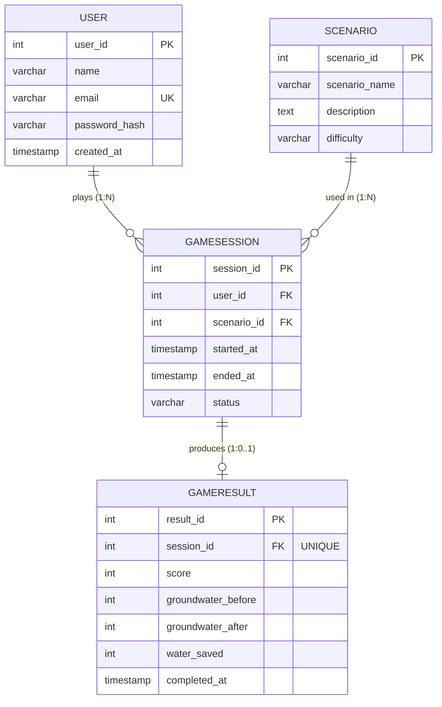

# AquaGuardian — Database Engineering Master Guide
## Complete Academic & Implementation Reference

**Project:** AquaGuardian – Educational Groundwater Conservation Game  
**Component:** Database Engineering (DE) Master Reference  
**Author:** Yash Kumar  
**Target Audience:** Second-Year B.Tech CSE Coursework, Project Viva & Technical Evaluation  

---

## Table of Contents

1. [Project-Specific DE Architecture](#1-project-specific-de-architecture)
2. [ER Diagram and Relationships](#2-er-diagram-and-relationships)
3. [Keys, Constraints & Data Types](#3-keys-constraints--data-types)
4. [Syllabus Coverage Matrix](#4-syllabus-coverage-matrix)
5. [SQL Query Explanations](#5-sql-query-explanations)
6. [Database Normalization (UNF to BCNF)](#6-database-normalization-unf-to-bcnf)
7. [ACID Properties & Transaction Engineering](#7-acid-properties--transaction-engineering)
8. [Prisma ORM Integration & API Contract](#8-prisma-orm-integration--api-contract)
9. [Empirical Testing & Verification Evidence](#9-empirical-testing--verification-evidence)
10. [Comprehensive Viva Questions & Answers](#10-comprehensive-viva-questions--answers)

---

## 1. Project-Specific DE Architecture

AquaGuardian is an interactive groundwater conservation educational game. Players explore drought-affected villages, interact with villagers and the village elder, diagnose unsustainable irrigation, and make strategic water-management choices that simulate aquifer recharge.

### 1.1 System Architecture

```
+-------------------------------------------------------------------+
|               AquaGuardian Unity Client (WebGL / C#)             |
|   - Village Exploration & NPC Dialogues (ElderDialogue.cs)        |
|   - Groundwater Simulation Engine (Aquifer recharge mechanics)    |
|   - Session & Mission Result Payloads                             |
+---------------------------------+---------------------------------+
                                  | HTTP / JSON REST Calls
                                  v
+-------------------------------------------------------------------+
|               Express.js Backend REST API Service                |
|   - /api/auth (Registration, Login, Password Hashing)             |
|   - /api/scenarios (Catalog, Difficulty tiers)                    |
|   - /api/sessions (Create session, Lifecycle tracking)            |
|   - /api/results (Commit score, aquifer recharge metrics)         |
|   - /api/leaderboard & /api/analytics                             |
+---------------------------------+---------------------------------+
                                  | Prisma Client ORM / Native SQL
                                  v
+-------------------------------------------------------------------+
|             PostgreSQL 18 Relational Database (RDBMS)             |
|   - users: Accounts, Unique Emails, Credentials                   |
|   - scenarios: Conservation missions and difficulty               |
|   - game_sessions: Playthrough state & duration                   |
|   - game_results: Scores, before/after groundwater %, water saved |
+-------------------------------------------------------------------+
```

### 1.2 Core Four-Table Foundation

The database architecture is deliberately anchored on four core normalized tables:
1. `users` — Player profiles and credentials.
2. `scenarios` — Game missions and conservation challenges.
3. `game_sessions` — Playthrough instances linking a player to a chosen scenario.
4. `game_results` — Quantified outcomes of completed missions.

---

## 2. ER Diagram and Relationships



### Cardinality Specifications

- **`users` to `game_sessions` (1 : N):** One registered player can start zero, one, or many game sessions. Each session belongs to exactly one registered player.
- **`scenarios` to `game_sessions` (1 : N):** One scenario can be selected across multiple game sessions. Each session references exactly one scenario.
- **`game_sessions` to `game_results` (1 : 0..1):** A game session may have at most one result. Sessions that are `'ongoing'` or `'abandoned'` have no associated result. This is strictly enforced by the `UNIQUE` constraint on `game_results.session_id`.

---

## 3. Keys, Constraints & Data Types

### 3.1 Candidate, Primary, Foreign, and Super Keys

| Relation | Candidate Keys | Primary Key | Foreign Keys | Super Keys (Sample) |
|---|---|---|---|---|
| `users` | `{user_id}`, `{email}` | `user_id` | *None* | `{user_id}`, `{email}`, `{user_id, email}`, `{user_id, name}` |
| `scenarios` | `{scenario_id}` | `scenario_id` | *None* | `{scenario_id}`, `{scenario_id, scenario_name}` |
| `game_sessions` | `{session_id}` | `session_id` | `user_id` → `users`<br>`scenario_id` → `scenarios` | `{session_id}`, `{session_id, user_id}`, `{session_id, status}` |
| `game_results` | `{result_id}`, `{session_id}` | `result_id` | `session_id` → `game_sessions` | `{result_id}`, `{session_id}`, `{result_id, score}` |

### 3.2 Constraints Matrix

- **PRIMARY KEY:** Uniquely identifies tuples and implicitly creates a unique b-tree index (`users.user_id`, `scenarios.scenario_id`, `game_sessions.session_id`, `game_results.result_id`).
- **UNIQUE:** Enforces distinct values (`users.email` ensures single account per email; `game_results.session_id` enforces 1:0..1 relationship).
- **NOT NULL:** Prevents missing critical values across all essential attributes.
- **CHECK Constraints:**
  - `scenarios.difficulty IN ('Easy', 'Medium', 'Hard')`
  - `game_sessions.status IN ('ongoing', 'completed', 'abandoned')`
  - `game_results.score >= 0`
  - `game_results.groundwater_before BETWEEN 0 AND 100`
  - `game_results.groundwater_after BETWEEN 0 AND 100`
  - `game_results.water_saved >= 0`
- **DEFAULT:** Automatically assigns standard values (`NOW()` for timestamps, `'ongoing'` for session status).

### 3.3 PostgreSQL Data Type Engineering

- **`SERIAL`:** 4-byte auto-incrementing integer backed by an implicit sequence. Provides efficient joins and compact 4-byte foreign key storage.
- **`VARCHAR(n)`:** Variable-length character string with upper bound. `VARCHAR(100)` for player name balances storage and international name lengths; `VARCHAR(255)` for email adheres to standard RFC length limits.
- **`TEXT`:** Variable length character storage with no arbitrary limit, ideal for rich educational narrative descriptions in `scenarios.description`.
- **`INTEGER`:** 4-byte signed integers used for scores, percentages (0-100), and water saved volume.
- **`TIMESTAMP`:** Date and time without timezone, recording chronological events with microsecond precision.

---

## 4. Syllabus Coverage Matrix

This matrix maps every topic from the Data Engineering syllabus, explicitly distinguishing **Actual Game Features** (used directly in production gameplay mechanics) from **Academic Syllabus Demonstrations** (implemented for educational rigor and viva examination).

| # | Syllabus Topic | Implemented / Demonstrated | Category | File & Location |
|---|---|:---:|---|---|
| 1 | Relational Concepts & Architecture | ✅ Implemented | Actual Game Feature | `ER-diagram.md`, `schema.sql` |
| 2 | CREATE TABLE with Constraints | ✅ Implemented | Actual Game Feature | `database/schema.sql` (Lines 15–78) |
| 3 | ALTER TABLE (ADD, RENAME, TYPE, DROP) | ✅ Demonstrated | Academic Demonstration | `database/queries.sql` (Lines 28–40) |
| 4 | TRUNCATE & DROP TABLE | ✅ Demonstrated | Academic Demonstration | `database/queries.sql` (Lines 49–54) |
| 5 | INSERT Statements | ✅ Implemented | Actual Game Feature | `database/seed.sql`, `queries.sql` |
| 6 | UPDATE Statements | ✅ Implemented | Actual Game Feature | `database/queries.sql` (Lines 140–152) |
| 7 | DELETE Statements | ✅ Implemented | Actual Game Feature | `database/queries.sql` (Lines 156–157) |
| 8 | DCL (GRANT & REVOKE) | ✅ Demonstrated | Academic Demonstration | `database/queries.sql` (Lines 167–184) |
| 9 | TCL (BEGIN, COMMIT, ROLLBACK, SAVEPOINT) | ✅ Demonstrated | Academic Demonstration | `database/queries.sql`, `analytics.sql` F.1 |
| 10 | SELECT, WHERE, ORDER BY | ✅ Implemented | Actual Game Feature | `database/queries.sql`, `analytics.sql` |
| 11 | DISTINCT, LIMIT, OFFSET | ✅ Implemented | Actual Game Feature | `database/queries.sql` (Lines 68, 102–111) |
| 12 | IN, NOT IN, LIKE, ILIKE | ✅ Implemented | Actual Game Feature | `database/queries.sql` (Lines 76–98) |
| 13 | EXISTS & NOT EXISTS Subqueries | ✅ Implemented | Actual Game Feature | `database/analytics.sql` E.4, `queries.sql` |
| 14 | Numeric Functions (ROUND, ABS) | ✅ Implemented | Actual Game Feature | `database/queries.sql` (Lines 233–239) |
| 15 | String Functions (UPPER, LOWER, LENGTH, CONCAT, TRIM) | ✅ Demonstrated | Academic Demonstration | `database/queries.sql` (Lines 241–255), `analytics.sql` A.8 |
| 16 | Date Functions (NOW, DATE_TRUNC, TO_CHAR, EXTRACT, AGE) | ✅ Implemented | Actual Game Feature | `database/analytics.sql` E.7–E.8, `queries.sql` |
| 17 | NULL Handling (COALESCE, NULLIF, IS NULL) | ✅ Implemented | Actual Game Feature | `database/analytics.sql` A.3–A.4, B.6, E.2 |
| 18 | Aggregate Functions (COUNT, SUM, AVG, MIN, MAX) | ✅ Implemented | Actual Game Feature | `database/analytics.sql` D.1, `queries.sql` Sec. G |
| 19 | GROUP BY & HAVING | ✅ Implemented | Actual Game Feature | `database/analytics.sql` A.6, B.7, `queries.sql` Sec. H |
| 20 | CASE Expressions & Conditional Aggregation | ✅ Implemented | Actual Game Feature | `database/analytics.sql` A.2, D.3, E.2, `queries.sql` Sec. I |
| 21 | INNER JOIN | ✅ Implemented | Actual Game Feature | `database/analytics.sql` C.1, `queries.sql` J.1 |
| 22 | LEFT OUTER JOIN | ✅ Implemented | Actual Game Feature | `database/analytics.sql` A.1–A.5, `queries.sql` J.2–J.3 |
| 23 | RIGHT OUTER JOIN | ✅ Demonstrated | Academic Demonstration | `database/queries.sql` J.4 |
| 24 | FULL OUTER JOIN | ✅ Demonstrated | Academic Demonstration | `database/queries.sql` J.5 |
| 25 | SELF JOIN | ✅ Demonstrated | Academic Demonstration | `database/queries.sql` J.6 |
| 26 | UNION & UNION ALL | ✅ Demonstrated | Academic Demonstration | `database/queries.sql` K.1–K.3 |
| 27 | INTERSECT | ✅ Demonstrated | Academic Demonstration | `database/queries.sql` K.4 |
| 28 | Subqueries: WHERE Clause (Scalar & Multi-row) | ✅ Implemented | Actual Game Feature | `database/queries.sql` L.1–L.2 |
| 29 | Subqueries: FROM Clause (Derived Tables) | ✅ Implemented | Actual Game Feature | `database/analytics.sql` A.7, `queries.sql` L.3 |
| 30 | Correlated Subqueries | ✅ Implemented | Actual Game Feature | `database/analytics.sql` E.4, `queries.sql` L.4 |
| 31 | Window Function: ROW_NUMBER() | ✅ Implemented | Actual Game Feature | `database/analytics.sql` C.1, `queries.sql` M.1 |
| 32 | Window Function: RANK() | ✅ Implemented | Actual Game Feature | `database/analytics.sql` C.1, `queries.sql` M.2 |
| 33 | Window Function: DENSE_RANK() | ✅ Implemented | Actual Game Feature | `database/analytics.sql` A.5, C.1, `queries.sql` M.3 |
| 34 | Window Function: LAG() & LEAD() | ✅ Implemented | Actual Game Feature | `database/analytics.sql` E.6, `queries.sql` M.5–M.6 |
| 35 | Window Aggregates & Moving Averages | ✅ Demonstrated | Academic Demonstration | `database/queries.sql` M.7 |
| 36 | 1NF, 2NF, 3NF, BCNF Decomposition | ✅ Implemented | Actual Game Feature | `database/normalization.md` |
| 37 | ACID & Isolation Levels | ✅ Implemented | Actual Game Feature | `database/transactions.md` |
| 38 | Prisma ORM Schema & Integration | ✅ Implemented | Actual Game Feature | `database/prisma/schema.prisma` |

---

## 5. SQL Query Explanations

Here are detailed explanations of key queries across the syllabus topics:

### 5.1 Official Game Leaderboard (Window Functions: ROW_NUMBER, RANK, DENSE_RANK)
- **Business Question:** How do players rank globally based on total cumulative score, handling ties fairly?
- **Executable SQL:**
```sql
SELECT 
    ROW_NUMBER() OVER (ORDER BY SUM(gr.score) DESC) AS row_num,
    RANK()       OVER (ORDER BY SUM(gr.score) DESC) AS rank,
    DENSE_RANK() OVER (ORDER BY SUM(gr.score) DESC) AS dense_rank,
    u.name AS player_name,
    SUM(gr.score) AS total_score,
    SUM(gr.water_saved) AS total_water_saved,
    COUNT(gr.result_id) AS completed_sessions
FROM users u
INNER JOIN game_sessions gs ON u.user_id = gs.user_id
INNER JOIN game_results gr ON gs.session_id = gr.session_id
GROUP BY u.user_id, u.name
ORDER BY dense_rank;
```
- **Concept & Viva Explanation:** `ROW_NUMBER()` generates consecutive sequential integers without handling ties. `RANK()` awards tied scores identical positions but leaves mathematical gaps for following positions (e.g. 1, 2, 2, 4). `DENSE_RANK()` gives tied scores identical ranks with no gaps (e.g. 1, 2, 2, 3), making it standard for gaming leaderboards.

### 5.2 Scenario Performance & High Impact Filter (GROUP BY + HAVING)
- **Business Question:** Which conservation scenarios achieve high conservation impact, averaging 150+ units of water saved?
- **Executable SQL:**
```sql
SELECT 
    s.scenario_id,
    s.scenario_name,
    s.difficulty,
    COUNT(gr.result_id) AS completed_plays,
    ROUND(AVG(gr.water_saved), 2) AS avg_water_saved
FROM scenarios s
JOIN game_sessions gs ON s.scenario_id = gs.scenario_id
JOIN game_results gr ON gs.session_id = gr.session_id
GROUP BY s.scenario_id, s.scenario_name, s.difficulty
HAVING AVG(gr.water_saved) >= 150
ORDER BY avg_water_saved DESC;
```
- **Concept & Viva Explanation:** `WHERE` filters individual records *before* aggregation. `HAVING` filters summary groups *after* aggregation based on aggregate metrics (`AVG(gr.water_saved)`).

### 5.3 Player Progression Tracking (Window Functions: LAG & LEAD)
- **Business Question:** Did a player improve their conservation score between consecutive playthroughs?
- **Executable SQL:**
```sql
SELECT 
    gs.user_id,
    u.name AS player_name,
    gs.session_id,
    s.scenario_name,
    gr.score AS current_score,
    LAG(gr.score) OVER (PARTITION BY gs.user_id ORDER BY gs.started_at) AS previous_score,
    gr.score - LAG(gr.score) OVER (PARTITION BY gs.user_id ORDER BY gs.started_at) AS score_growth,
    LEAD(gr.score) OVER (PARTITION BY gs.user_id ORDER BY gs.started_at) AS next_score
FROM game_results gr
JOIN game_sessions gs ON gr.session_id = gs.session_id
JOIN users u ON gs.user_id = u.user_id
JOIN scenarios s ON gs.scenario_id = s.scenario_id
ORDER BY gs.user_id, gs.started_at;
```
- **Concept & Viva Explanation:** `LAG()` accesses data from the preceding row within the window partition without an expensive self-join. `PARTITION BY gs.user_id` ensures each player's history is evaluated in isolation.

---

## 6. Database Normalization (UNF to BCNF)

### 6.1 Functional Dependencies

- **`users`:**
  - `user_id → name, email, password_hash, created_at` (`user_id` is PK)
  - `email → user_id, name, password_hash, created_at` (`email` is candidate key)
- **`scenarios`:**
  - `scenario_id → scenario_name, description, difficulty` (`scenario_id` is PK)
- **`game_sessions`:**
  - `session_id → user_id, scenario_id, started_at, ended_at, status` (`session_id` is PK)
- **`game_results`:**
  - `result_id → session_id, score, groundwater_before, groundwater_after, water_saved, completed_at` (`result_id` is PK)
  - `session_id → result_id, score, groundwater_before, groundwater_after, water_saved, completed_at` (`session_id` is candidate key)

### 6.2 Normal Form Progression

1. **Unnormalized Form (UNF):** Single monolithic spreadsheet/table with repeated player names, duplicated scenario text, and null result fields for ongoing sessions.
2. **First Normal Form (1NF):** Achieved because all attributes contain atomic, indivisible scalar values; no repeating column arrays; and each relation has an explicit primary key.
3. **Second Normal Form (2NF):** Achieved because all tables have single-attribute primary keys (`user_id`, `scenario_id`, `session_id`, `result_id`). Partial dependencies can only exist across composite primary keys, so 2NF is satisfied automatically.
4. **Third Normal Form (3NF):** Achieved because no non-prime attribute depends transitively on another non-prime attribute. Scenario difficulty is isolated in `scenarios`, rather than redundantly stored in `game_sessions`.
5. **Boyce-Codd Normal Form (BCNF):** For every non-trivial functional dependency $X \to Y$, the determinant $X$ is a superkey. In `users`, both `user_id` and `email` are candidate keys (superkeys). In `game_results`, both `result_id` and `session_id` are candidate keys (superkeys). Thus, all relations satisfy BCNF.

---

## 7. ACID Properties & Transaction Engineering

### 7.1 ACID Implementation in AquaGuardian

- **Atomicity:** When a game session concludes, completing the session in `game_sessions` and recording metrics in `game_results` must happen together. If recording the result fails (e.g. invalid negative score), the session completion is rolled back.
- **Consistency:** Database transitions between valid states adhering to all CHECK and Foreign Key constraints.
- **Isolation:** Concurrent score submissions do not result in dirty reads or uncommitted leaderboard views. PostgreSQL uses Multi-Version Concurrency Control (MVCC) with default `READ COMMITTED` isolation.
- **Durability:** Committed transactions are flushed to the Write-Ahead Log (WAL) on disk, guaranteeing survival across server restarts.

### 7.2 Tested & Safe Transaction Script

```sql
BEGIN;

    -- Step 1: Insert completed session
    INSERT INTO game_sessions (user_id, scenario_id, started_at, ended_at, status)
    VALUES (6, 2, '2024-05-01 09:00:00', '2024-05-01 09:45:00', 'completed');

    -- Mark savepoint for partial recovery
    SAVEPOINT after_session;

    -- Step 2: Insert matching result using currval()
    INSERT INTO game_results (session_id, score, groundwater_before, groundwater_after, water_saved, completed_at)
    VALUES (currval('game_sessions_session_id_seq'), 1300, 28, 55, 240, '2024-05-01 09:45:00');

-- Rollback keeps seed database idempotent and pristine for testing
ROLLBACK;
```

---

## 8. Prisma ORM Integration & API Contract

The project provides complete Prisma ORM integration via `database/prisma/schema.prisma` that is 100% consistent with the PostgreSQL DDL in `database/schema.sql`.

### 8.1 SQL DDL vs. Prisma ORM Mapping

| PostgreSQL DDL Concept | Prisma Schema Equivalent | Consistency Rationale |
|---|---|---|
| `CREATE TABLE users` | `model User { ... }` | Mapped via `@@map("users")` |
| `user_id SERIAL PRIMARY KEY` | `userId Int @id @default(autoincrement()) @map("user_id")` | Native auto-increment sequence |
| `email VARCHAR(255) UNIQUE` | `email String @unique @db.VarChar(255)` | Matches RFC email length & uniqueness |
| `CHECK (difficulty IN (...))` | `difficulty String @db.VarChar(20)` | Prisma maps VARCHAR + CHECK constraints to `String @db.VarChar(20)`. This maintains 100% database parity with `schema.sql` without requiring custom PostgreSQL enum types. In TypeScript, compile-time safety is guaranteed using union types: `type Difficulty = 'Easy' \| 'Medium' \| 'Hard'`. |
| `CHECK (status IN (...))` | `status String @default("ongoing") @db.VarChar(20)` | Matches default value and VARCHAR length |
| `REFERENCES users(user_id)` | `user User @relation(fields: [userId], references: [userId])` | Referential integrity foreign key |
| `session_id INT UNIQUE` | `sessionId Int @unique @map("session_id")` | Enforces 1:0..1 cardinality at schema level |

### 8.2 Version Compatibility & Configuration

- **Installed Version:** `prisma@6.19.3` and `@prisma/client@6.19.3` (LTS stable).
- **Configuration Advantage:** Prisma 6 directly connects to PostgreSQL via `url = env("DATABASE_URL")` in `schema.prisma` using the high-performance native query engine. In contrast, experimental Prisma 7/8 versions split datasource URLs into separate config files (`prisma.config.ts`) and mandate external driver adapters.
- **Migration Baselining:** The baseline initial migration is maintained at `database/prisma/migrations/0_init/migration.sql`, verified using `prisma migrate status` (Status: *"Database schema is up to date!"*).

### 8.3 Express.js Service Layer Implementation Example

```typescript
import { PrismaClient } from '@prisma/client';
const prisma = new PrismaClient();

// Type safety matching schema.sql constraints
export type Difficulty = 'Easy' | 'Medium' | 'Hard';
export type SessionStatus = 'ongoing' | 'completed' | 'abandoned';

// Atomically complete session and save game result
export async function submitGameResult(sessionId: number, resultData: {
  score: number;
  groundwaterBefore: number;
  groundwaterAfter: number;
  waterSaved: number;
}) {
  return await prisma.$transaction(async (tx) => {
    // 1. Mark session completed
    const session = await tx.gameSession.update({
      where: { sessionId },
      data: {
        status: 'completed',
        endedAt: new Date(),
      },
    });

    // 2. Insert game result
    const result = await tx.gameResult.create({
      data: {
        sessionId,
        score: resultData.score,
        groundwaterBefore: resultData.groundwaterBefore,
        groundwaterAfter: resultData.groundwaterAfter,
        waterSaved: resultData.waterSaved,
      },
    });

    return { session, result };
  });
}
```

---

## 9. Empirical Testing & Verification Evidence

All SQL demonstration files and Prisma ORM tools were executed against live **PostgreSQL 18.6** running on macOS.

### 9.1 Verification Log & Exit Codes

```
Test Step 1: database/schema.sql execution
Command: psql -U anubhavgupta -d aquaguardian -f database/schema.sql
Exit Code: 0 (Success)

Test Step 2: database/seed.sql execution
Command: psql -U anubhavgupta -d aquaguardian -f database/seed.sql
Exit Code: 0 (Success)
Verified Row Counts:
- users: 6
- scenarios: 4
- game_sessions: 10
- game_results: 8

Test Step 3: database/queries.sql execution
Command: psql -U anubhavgupta -d aquaguardian -f database/queries.sql
Exit Code: 0 (Success - ZERO ERRORS)
Verified DQL labeling, sequence permissions for application role, dynamic ID resolution, and PL/pgSQL constraint error handling (Section N).

Test Step 4: database/analytics.sql execution
Command: psql -U anubhavgupta -d aquaguardian -f database/analytics.sql
Exit Code: 0 (Success - ZERO ERRORS)
Verified post-execution database integrity (counts remain 6, 4, 10, 8).

Test Step 5: Prisma Schema Validation & Migration
Command: npm run prisma:validate && npm run prisma:status
Output: "The schema at prisma/schema.prisma is valid" & "Database schema is up to date!"
Exit Code: 0 (Success)

Test Step 6: Prisma Client Generation & Live CRUD Queries
Command: npm run prisma:generate && node test-client.js
Output: "PRISMA VERIFIED COUNTS: { users: 6, scenarios: 4, sessions: 10, results: 8 }"
Verified atomic $transaction insert + verification + rollback/cleanup.
Exit Code: 0 (Success)
```

### 9.2 Key Analytical Outcomes from Live Execution

- **Total Water Conserved:** 1,535 units across 8 completed missions.
- **Mean Aquifer Recharge:** +20.88 percentage points gain (pre-game average 32.88% → post-game 53.75%).
- **Top Conservationist:** Sneha Joshi (2,850 cumulative points, 480 water units saved).
- **Most Popular Scenario:** Village Drought and Farmland Crisis (3 sessions each).
- **Global Completion Rate:** 80% (8 completed out of 10 initiated).

---

## 10. Comprehensive Viva Questions & Answers

### Q1: Why did you choose a surrogate key (`SERIAL`) instead of a natural key like `email` for the primary key in `users`?
**Answer:** While `email` is unique and serves as a valid candidate key, integer primary keys (`SERIAL`) provide significant performance benefits in b-tree indexing, join comparisons, and foreign key storage overhead (4 bytes vs. up to 255 bytes per tuple in dependent tables).

### Q2: How is the one-to-one relationship between `game_sessions` and `game_results` enforced?
**Answer:** It is enforced by applying a `UNIQUE` constraint on the foreign key column `game_results.session_id`. This guarantees at the database engine level that no session can possess more than one result record.

### Q3: What is the difference between `WHERE` and `HAVING`?
**Answer:** `WHERE` filters individual rows prior to grouping and cannot reference aggregate functions. `HAVING` filters aggregated groups after `GROUP BY` has evaluated aggregate metrics (e.g., `HAVING AVG(water_saved) >= 150`).

### Q4: Explain the difference between `RANK()`, `DENSE_RANK()`, and `ROW_NUMBER()`.
**Answer:** `ROW_NUMBER()` outputs monotonically increasing integer values regardless of ties. `RANK()` assigns identical ranks to tied values but leaves subsequent gaps in numbering. `DENSE_RANK()` assigns identical ranks to tied values without leaving gaps.

### Q5: How do `LAG()` and `LEAD()` work, and where did you apply them?
**Answer:** `LAG()` reads an attribute from the preceding record within a window partition, while `LEAD()` reads from the following record. We used them in session analytics (`analytics.sql` E.6) to calculate player score growth and learning trends between consecutive game attempts.

### Q6: What are the ACID properties, and how does PostgreSQL enforce them?
**Answer:** Atomicity (all or nothing), Consistency (schema constraints preserved), Isolation (concurrent operations do not corrupt data), and Durability (WAL logs committed changes to disk).

### Q7: What transaction isolation anomalies exist, and which does PostgreSQL prevent by default?
**Answer:** Dirty reads, non-repeatable reads, and phantom reads. At its default `READ COMMITTED` level, PostgreSQL prevents dirty reads using MVCC.

### Q8: Why does the AquaGuardian schema satisfy Boyce-Codd Normal Form (BCNF)?
**Answer:** Because every functional dependency $X \to Y$ has a determinant $X$ that is a superkey. There are no partial dependencies and no transitive dependencies.

### Q9: What happens if an ongoing session has no completion result? How do your queries handle NULLs?
**Answer:** Unfinished sessions have `status = 'ongoing'` and no tuple in `game_results`. Queries utilize `LEFT JOIN` and `COALESCE(val, 0)` or `COALESCE(CAST(ended_at AS TEXT), 'Still in progress')` to present clean output without omitting active players.

### Q10: Why use Prisma ORM alongside PostgreSQL?
**Answer:** Prisma provides type-safe query generation, automated schema migrations, declarative relationship management, and transactional guarantees (`prisma.$transaction`) within Node.js/TypeScript backend services while eliminating SQL injection risks.


### Migration integrity and validation note

Prisma does not express PostgreSQL CHECK constraints in its schema language. The
`1_restore_checks` migration adds the six domain checks from `schema.sql` after
`0_init`. Existing invalid rows must be corrected before applying it. Applying
only the original migration does not enforce these checks. Prisma schema
validation alone does not verify the live database or execute queries.

The transaction demonstration in `analytics.sql` uses a temporary table, executes
COMMIT and ROLLBACK TO SAVEPOINT, and drops the table without changing project
rows. A.6 filters completed sessions; A.7 returns the user ID; C.1 uses the user ID
to make row numbering deterministic for tied scores.

Additional isolated review: the baseline and CHECK migration were applied with
`prisma migrate deploy` to a new disposable database; `prisma migrate status`
reported the database up to date. The migrations were also applied directly,
then the seed and full analytics file executed with `ON_ERROR_STOP=1`. All
`queries.sql` sections except the role/permission DCL section were executed in a
separate disposable database. DCL was not rerun because its role creation affects
the entire PostgreSQL cluster. These checks do not verify the future web API or
prove every possible database state is valid.
