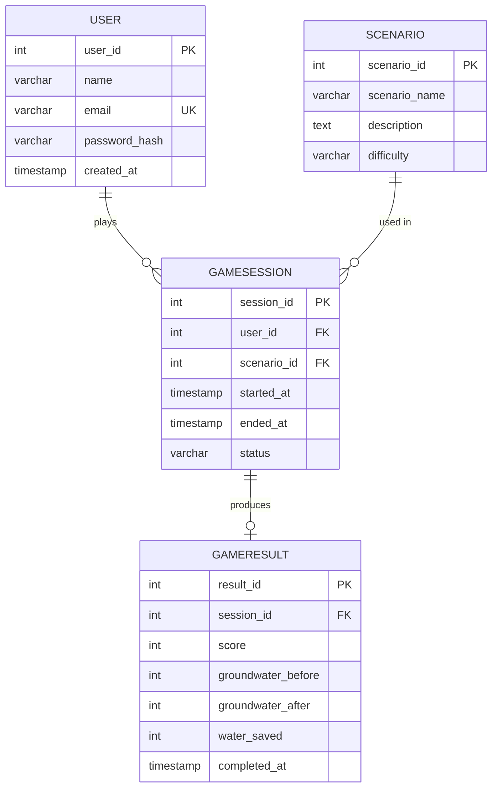

# AquaGuardian – ER Diagram (Checkpoint 1)

## Entity-Relationship Diagram

---

## Relationship Explanations

| Relationship | Cardinality | Meaning |
|---|---|---|
| USER → GAMESESSION | One-to-Many | A single user can start many game sessions over time, but each session belongs to exactly one user. |
| SCENARIO → GAMESESSION | One-to-Many | A single scenario (e.g., "Drought Crisis") can be played in many sessions, but each session runs exactly one scenario. |
| GAMESESSION → GAMERESULT | One-to-One (at most) | A session may have **at most one** result. The `session_id` column in `GameResult` is marked UNIQUE to enforce this. A session might not have a result yet (e.g., still in progress). |

---

## Key Constraints Summary

| Entity | Primary Key | Foreign Keys | Unique Columns |
|---|---|---|---|
| User | `user_id` | — | `email` |
| Scenario | `scenario_id` | — | — |
| GameSession | `session_id` | `user_id` → User, `scenario_id` → Scenario | — |
| GameResult | `result_id` | `session_id` → GameSession | `session_id` |

---

## Normalization Notes (Beginner-Friendly)

This design follows the basic idea of **keeping each fact in one place** so we do not repeat data unnecessarily.

### Why four separate tables?

1. **User** – Stores login and profile information once per person. We do not copy the user's name or email into every session row; we just store the `user_id` as a foreign key.

2. **Scenario** – Stores the description and difficulty of each game scenario once. Many sessions can reference the same scenario without duplicating its text.

3. **GameSession** – Stores only what is specific to one play-through (who played, which scenario, when it started/ended, and its status). It references `User` and `Scenario` by ID, avoiding duplication.

4. **GameResult** – Stores the outcome (score, groundwater values) separately from the session. This keeps the session table clean and allows a session to exist before its result is recorded (i.e., while still in progress).

### What problem does this solve?

If we had put everything in one giant table, the same user name and scenario description would be repeated in every row. That wastes storage and means a typo fix requires updating many rows instead of one. By separating the data into four entities and linking them with foreign keys, each piece of information lives in exactly one place.

This is the basic principle behind **First and Second Normal Form (1NF / 2NF)**: each table stores facts about one thing, and every non-key column depends on the full primary key of that table.
