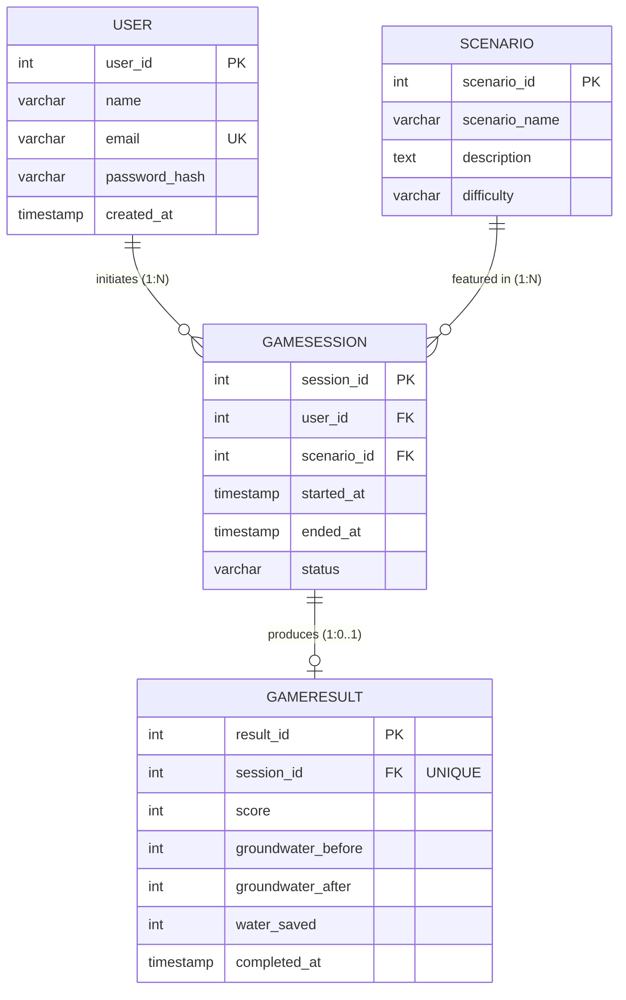

# AquaGuardian – ER Diagram & Database Design Specification

**Project:** AquaGuardian – Groundwater Conservation Educational Game  
**Component:** Database Engineering (DE) Task 1 & Task 2  
**Author:** Yash Kumar  

---

## 1. RDBMS Fundamentals Applied to AquaGuardian

A Relational Database Management System (RDBMS) organizes structured data into two-dimensional tables (**relations**), where:
- Each row represents a single record (**tuple**), e.g., one player account or one completed game session.
- Each column represents a typed named property (**attribute**), e.g., `score` or `started_at`.
- The database enforces mathematical relations via set operations, keys, and relational algebra.

### Core Relational Concepts in AquaGuardian

| Concept | Definition | AquaGuardian Implementation |
|---|---|---|
| **Relation (Table)** | A named set of tuples sharing identical attribute types. | `users`, `scenarios`, `game_sessions`, `game_results`. |
| **Tuple (Row)** | An individual instance of data in a relation. | Record for player Aarav Sharma (`user_id = 1`). |
| **Attribute (Column)** | A domain-specific property within a table. | `water_saved` (INTEGER ≥ 0). |
| **Database Schema** | Structural blueprint (tables, types, constraints). | Definitions in `database/schema.sql`. |
| **Database Instance** | Snapshot of actual data at a specific moment in time. | Current seed data (6 users, 4 scenarios, 10 sessions, 8 results). |
| **Domain** | The permissible set of values for an attribute. | `difficulty` domain: `{'Easy', 'Medium', 'Hard'}`. |

---

## 2. Entity-Relationship (ER) Diagram



---

## 3. Entities, Attributes and Relationships

### 3.1 `users` Entity
- **Purpose:** Stores authenticated player accounts.
- **Attributes:**
  - `user_id` (INTEGER, PK): System-assigned surrogate primary key.
  - `name` (VARCHAR(100)): Player's profile or display name.
  - `email` (VARCHAR(255), UK): Unique email used for registration and login.
  - `password_hash` (VARCHAR(255)): Cryptographic hash of player's password.
  - `created_at` (TIMESTAMP): Account registration timestamp.

### 3.2 `scenarios` Entity
- **Purpose:** Catalog of game scenarios designed to teach conservation principles.
- **Attributes:**
  - `scenario_id` (INTEGER, PK): Primary key identifying the scenario.
  - `scenario_name` (VARCHAR(150)): Mission title shown in UI menus (e.g., "Village Drought").
  - `description` (TEXT): Educational context, environmental challenge, and player objective.
  - `difficulty` (VARCHAR(20)): Complexity tier constrained to `'Easy'`, `'Medium'`, or `'Hard'`.

### 3.3 `game_sessions` Entity
- **Purpose:** Represents an active or historical play-through by a user on a given scenario.
- **Attributes:**
  - `session_id` (INTEGER, PK): Unique surrogate session identifier.
  - `user_id` (INTEGER, FK): Identifies the user who initiated the session.
  - `scenario_id` (INTEGER, FK): Identifies the scenario played.
  - `started_at` (TIMESTAMP): Session start timestamp.
  - `ended_at` (TIMESTAMP, Nullable): Completion/abandonment timestamp (NULL if currently ongoing).
  - `status` (VARCHAR(20)): Lifecycle state (`'ongoing'`, `'completed'`, `'abandoned'`).

### 3.4 `game_results` Entity
- **Purpose:** Stores the quantified outcomes of a completed session.
- **Attributes:**
  - `result_id` (INTEGER, PK): Primary key for the result entry.
  - `session_id` (INTEGER, FK, UK): Session link with strict 1:1 uniqueness constraint.
  - `score` (INTEGER): Points earned from player choices.
  - `groundwater_before` (INTEGER): Pre-game groundwater aquifer level (0–100%).
  - `groundwater_after` (INTEGER): Post-game groundwater aquifer level (0–100%).
  - `water_saved` (INTEGER): Volume of groundwater conserved (in kilolitres/units).
  - `completed_at` (TIMESTAMP): Timestamp when result was committed.

---

## 4. Key Classifications: Super, Candidate, Primary, Foreign

| Table | Candidate Keys | Primary Key | Foreign Keys | Super Keys (Examples) |
|---|---|---|---|---|
| `users` | `{user_id}`, `{email}` | `user_id` | *None* | `{user_id}`, `{email}`, `{user_id, email}`, `{user_id, name}` |
| `scenarios` | `{scenario_id}` | `scenario_id` | *None* | `{scenario_id}`, `{scenario_id, scenario_name}` |
| `game_sessions` | `{session_id}` | `session_id` | `user_id` → `users(user_id)`<br>`scenario_id` → `scenarios(scenario_id)` | `{session_id}`, `{session_id, user_id}`, `{session_id, scenario_id}` |
| `game_results` | `{result_id}`, `{session_id}` | `result_id` | `session_id` → `game_sessions(session_id)` | `{result_id}`, `{session_id}`, `{result_id, score}` |

### Detailed Distinctions
- **Super Key:** Any set of attributes that uniquely determines a tuple in a relation.
- **Candidate Key:** A minimal super key (no attribute can be discarded without losing uniqueness).
- **Primary Key:** The candidate key chosen by the database architect as the tuple identifier.
- **Foreign Key:** An attribute whose values refer to a primary/candidate key in another relation.

In `users`, both `user_id` and `email` are candidate keys. `user_id` was chosen as primary key because integer comparison is significantly faster in index b-trees and foreign key join checks than variable-length strings.

---

## 5. Constraints and Referential Integrity

### 5.1 Constraint Catalog

```sql
-- Primary Keys
users.user_id              --> PRIMARY KEY
scenarios.scenario_id      --> PRIMARY KEY
game_sessions.session_id   --> PRIMARY KEY
game_results.result_id     --> PRIMARY KEY

-- Unique Constraints
users.email                --> UNIQUE
game_results.session_id    --> UNIQUE (ensures at most 1 result per session)

-- Check Constraints
scenarios.difficulty       --> CHECK (difficulty IN ('Easy', 'Medium', 'Hard'))
game_sessions.status       --> CHECK (status IN ('ongoing', 'completed', 'abandoned'))
game_results.score         --> CHECK (score >= 0)
game_results.groundwater_before --> CHECK (groundwater_before BETWEEN 0 AND 100)
game_results.groundwater_after  --> CHECK (groundwater_after BETWEEN 0 AND 100)
game_results.water_saved   --> CHECK (water_saved >= 0)

-- Default Constraints
users.created_at           --> DEFAULT NOW()
game_sessions.started_at   --> DEFAULT NOW()
game_sessions.status       --> DEFAULT 'ongoing'
game_results.completed_at  --> DEFAULT NOW()
```

### 5.2 Referential Integrity Rules
- `game_sessions.user_id` references `users(user_id)`: A session cannot be initiated by a non-existent player.
- `game_sessions.scenario_id` references `scenarios(scenario_id)`: Sessions must link to an official scenario.
- `game_results.session_id` references `game_sessions(session_id)`: A result cannot exist without an initiating session.

---

## 6. PostgreSQL Data Types Selection Rationale

| Column | Data Type | Engineering Rationale |
|---|---|---|
| `*_id` | `SERIAL` (INTEGER + sequence) | Auto-incrementing 4-byte integer handling up to 2.14 billion rows, optimal for index efficiency and memory footprint. |
| `name` | `VARCHAR(100)` | Accommodates full names internationally while bounding space allocation. |
| `email` | `VARCHAR(255)` | Matches RFC 5321 standard maximum path length for email addresses. |
| `password_hash` | `VARCHAR(255)` | Fixed length sufficient for standard cryptographic hashes (bcrypt, Argon2, SHA-256). |
| `description` | `TEXT` | Variable-length string allowing rich story context without arbitrary length truncation. |
| `difficulty` / `status` | `VARCHAR(20)` | Clean human-readable enumeration coupled with CHECK constraint for schema-level safety. |
| `score`, `water_saved` | `INTEGER` | Discrete non-negative integer counts; prevents fractional rounding anomalies. |
| `groundwater_*` | `INTEGER` | Percentage representation (0% to 100%) mapped directly to game aquifer mechanics. |
| `*_at` | `TIMESTAMP` | ISO 8601 millisecond-precision chronological tracking for performance analytics and session duration calculation. |

---

## 7. Persistent Story & NPC Progression Architecture

The AquaGuardian gameplay features village exploration and NPC dialogue (such as speaking to the Village Elder via `ElderDialogue.cs`).

### Architecture: In-Memory vs. Persistent Progression
1. **Current Core (In-Memory Session State):**  
   During a session, NPC dialogue state (`dialogueIndex`) is managed inside the Unity client runtime. When the session reaches conclusion, aggregate results (score, aquifer recovery, water saved) are persisted to `game_results`.
2. **Persistent Quest / Dialogue Extension (Optional Schema Design):**  
   If persistent cross-session storyline checkpoints are required in future releases, the model cleanly extends via a 5th table:
   ```sql
   CREATE TABLE player_quest_progress (
       progress_id    SERIAL PRIMARY KEY,
       user_id        INTEGER NOT NULL REFERENCES users(user_id) ON DELETE CASCADE,
       npc_name       VARCHAR(100) NOT NULL,
       dialogue_stage INTEGER NOT NULL DEFAULT 0,
       quest_completed BOOLEAN NOT NULL DEFAULT FALSE,
       updated_at     TIMESTAMP NOT NULL DEFAULT NOW(),
       UNIQUE(user_id, npc_name)
   );
   ```
   This maintains strict BCNF without disrupting the core 4-table session-results foundation.
